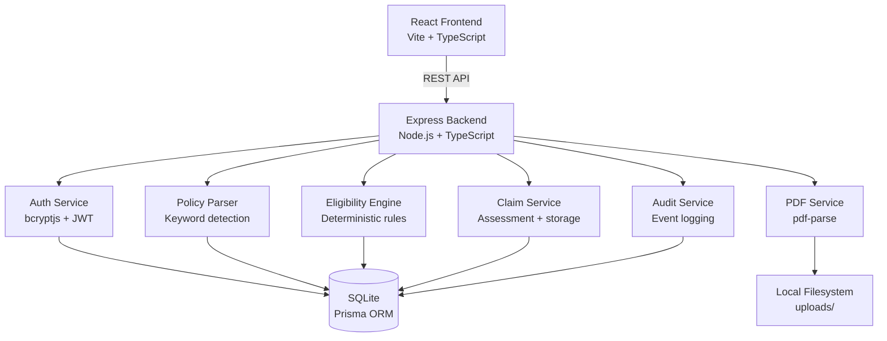

# Architecture — Warranty Eligibility Assistant

## Overview

```
┌────────────────────────────────────────────────────────────────────┐
│                         Browser (React + Vite)                      │
│  Login → Dashboard → Policies → New Claim → Result → History       │
└────────────────────┬───────────────────────────────────────────────┘
                     │ HTTP / REST (JSON)
                     ▼
┌────────────────────────────────────────────────────────────────────┐
│                   Express REST API  (port 3001)                     │
│  ┌─────────────┐  ┌──────────┐  ┌────────────┐  ┌─────────────┐  │
│  │  Auth Routes │  │ Policy   │  │  Claim     │  │  Admin      │  │
│  │  /api/auth   │  │ Routes   │  │  Routes    │  │  Routes     │  │
│  └──────┬──────┘  └────┬─────┘  └─────┬──────┘  └──────┬──────┘  │
│         │              │              │                  │          │
│  ┌──────▼──────────────▼──────────────▼──────────────────▼──────┐  │
│  │                   Middleware Layer                             │  │
│  │  requestId → authenticate → authorize → validate → handler   │  │
│  └───────────────────────────────────────────────────────────────┘  │
│         │                                                           │
│  ┌──────▼────────────────────────────────────────────────────────┐  │
│  │                   Service Layer                                │  │
│  │  authService  pdfService  policyParser  eligibilityEngine     │  │
│  │  claimService  auditService                                   │  │
│  └──────┬────────────────────────────────────────────────────────┘  │
│         │                                                           │
│  ┌──────▼────────────────────┐   ┌──────────────────────────────┐  │
│  │   Prisma ORM              │   │   Local Filesystem            │  │
│  │   SQLite (dev.db)         │   │   uploads/ (PDF files)        │  │
│  └───────────────────────────┘   └──────────────────────────────┘  │
└────────────────────────────────────────────────────────────────────┘
```

## Data Flow — Claim Assessment

```
1. User submits claim form (policyId, dates, issueType, description, proof)
        │
2. Express validates input (Zod schema)
        │
3. Load policy from SQLite (with confirmed clauses)
        │
4. EligibilityEngine.runRules(input, policy)
   ├── Rule 1: Required fields present?
   ├── Rule 2: Policy confirmed and active?
   ├── Rule 3: Dates valid (no future purchase, issue ≥ purchase)?
   ├── Rule 4: Issue date within warranty period?
   ├── Rule 5: Issue type/description matches any exclusion clause?
   ├── Rule 6: Proof of purchase satisfied?
   ├── Rule 7: All checks pass → MEETS_BASIC_CHECKS
   └── Rule 8: Uncertainty guard → MANUAL_REVIEW
        │
5. Save ClaimCheck record (referenceCode, result, ruleResults JSON)
        │
6. Return {claim, assessment} with supporting evidence and rule details
        │
7. React renders result page with ResultBadge, RuleRows, EvidenceCards
```

## PDF Ingestion Pipeline (Module 2)

```
Upload PDF → Validate (magic bytes, size, page limit)
           → Generate random stored filename
           → Compute SHA-256 hash
           → pdf-parse extracts page-by-page text
           → Detect if scanned (too little text → NEEDS_OCR)
           → policyParser: keyword regex scan for duration/exclusions/proof
           → Store Policy + PolicyClause records (unconfirmed)
           → Reviewer confirms/edits → isConfirmed = true
           → Policy now eligible for eligibility checks
```

## Mermaid Architecture Diagram



## Modules Demonstrated

### Module 1 — Cloud Product & Platform Engineering
- Modular Express app with separated routes, controllers, services
- Documented REST API with Swagger/OpenAPI at `/api/docs`
- Environment-based configuration (`.env`)
- `Dockerfile` + `docker-compose.yml` for containerised execution
- GitHub Actions CI pipeline (`.github/workflows/ci.yml`)
- Health endpoint at `GET /api/health`

### Module 2 — Data Engineering & ML Insights
- PDF ingestion pipeline: upload → validate → extract → normalize → store
- Page-level text mapping preserved in database
- Keyword-based clause detection (NLP without external models)
- Structured storage: Policy, PolicyClause, ClaimCheck tables
- Claim statistics API for dashboard metrics
- Rule-based classification (extensible to scikit-learn ML model)

### Module 3 — Generative AI & RAG
- Evidence retrieval: for each rule result, the relevant clause text and page
  number is fetched and returned alongside the explanation
- Source-grounded responses: every assessment explanation cites the policy clause
- Retrieval-Augmented pattern: input → retrieve relevant clauses → generate
  structured explanation from retrieved evidence only
- No LLM makes eligibility decisions; all decisions are deterministic rules
- Extension path documented: add Ollama + embeddings + FAISS for semantic search

### Module 4 — Cloud Security & Governance
- Passwords hashed with bcryptjs (Argon2-compatible workflow)
- JWT tokens with expiration; role extracted from token
- RBAC enforced in middleware on every protected route
- File validation: PDF magic bytes, MIME type, size limit, random storage name
- Path traversal prevention: uploads stored outside public directory
- Audit logging: all login attempts, uploads, assessments, reviews recorded
- Rate limiting on login endpoint (express-rate-limit)
- Security headers via helmet
- Parameterised queries via Prisma (no raw SQL concatenation)
- Secrets in `.env` (excluded from git)
